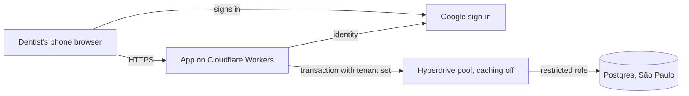
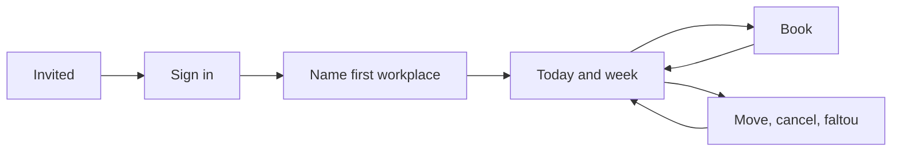
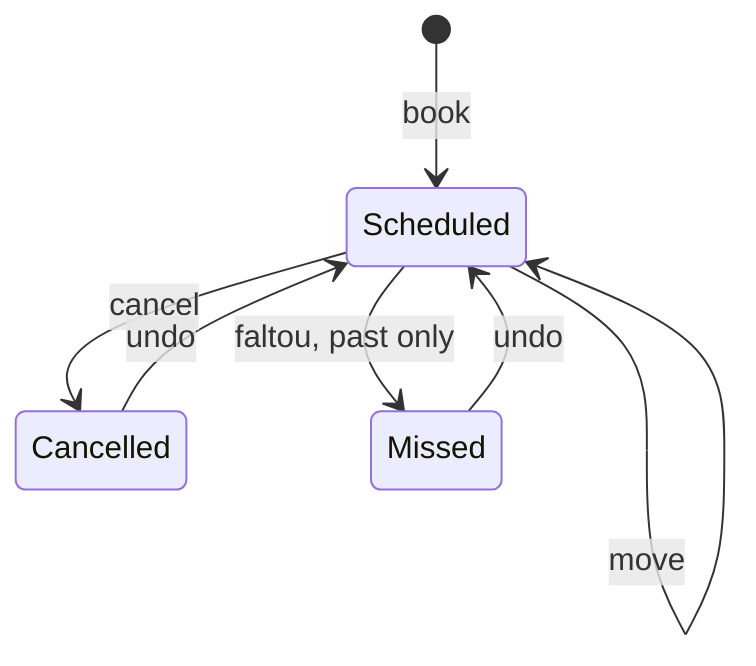
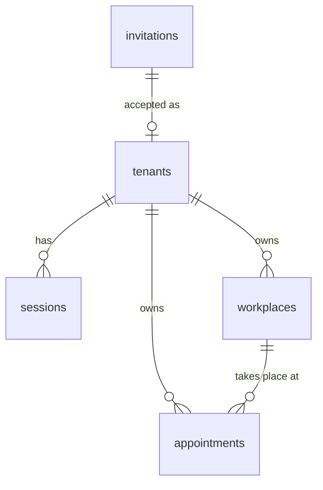
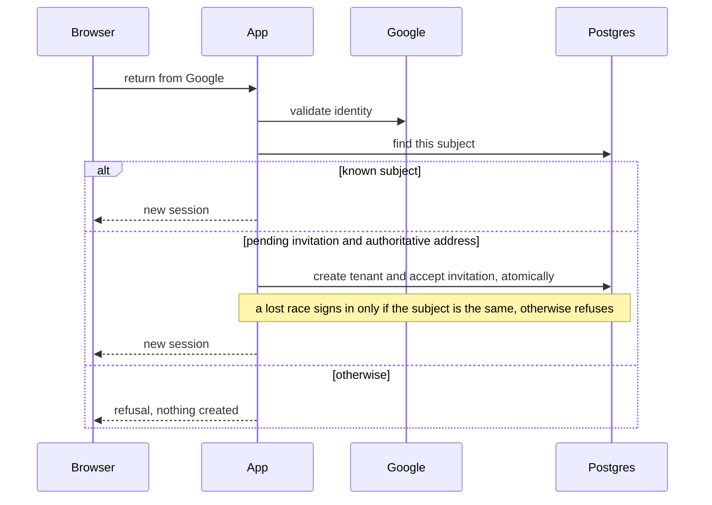
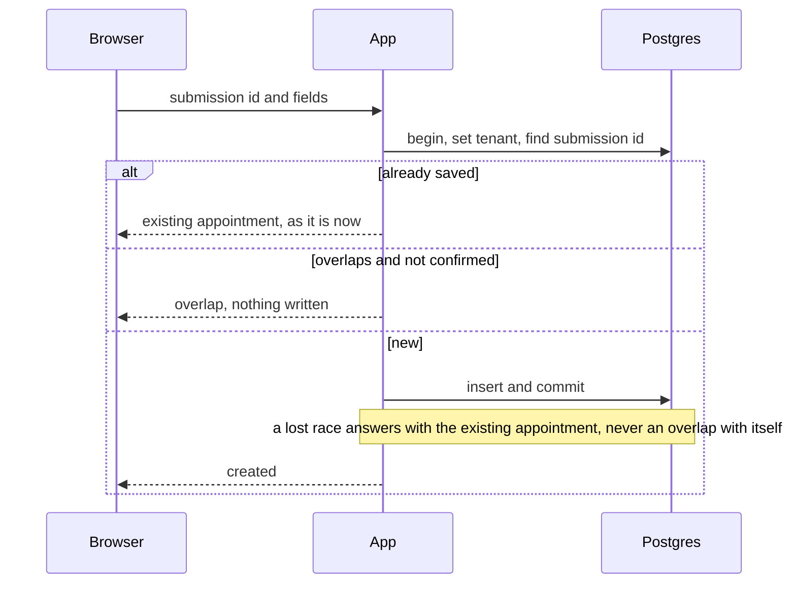

# Fairy first version: one agenda across every workplace

| | |
|---|---|
| **Status** | confirmed by obogoni (project owner), 2026-11-22: build, scope, journey, Postgres and order. Proposed, for review here: provider plan, D4, D5 and slice defaults |
| **Ready to plan?** | None yet. Tenant waits on the Conventions spike, which sets engineering rules. The other four also wait on Agenda screens, the design session |
| **Blocks go-live** | All five slices and every go-live row in Open |
| **Review** | Day 30 after the pilot dentist's first real use: obogoni (project owner) and the pilot dentist |

**How to read.** From Summary to Open is the design the team aligns on. Slices cuts the work: one section per slice, with its rules, its contract and the data that matters. The spec of each feature starts from its slice and details the rest against the code.

## Summary

The pilot dentist works in several places and keeps appointments in a paper notebook, although a clinic system exists. Fairy's first version is that dentist's agenda on the phone. It does not hold clinical records, take payments or message patients.

1. One dentist is one tenant, and gets in only by invitation.
2. One week shows every workplace, with no switching.
3. Booking is as quick as paper: overlaps warn and never refuse, and a retry never duplicates.
4. Postgres in São Paulo enforces the separation between tenants.

**What is expensive to get wrong:** tenant isolation. The records are health data, the usual setup guides switch isolation off silently, and retrofitting it means changing every table and query.

## Context and problem

**Where the project is.** Not shipped. The repository holds guidelines and agent skills, with no product code.

**Why build.** The project owner committed on 2026-11-22 to learn and to help the pilot dentist. Fairy may become a product later.

**Who hurts.** The pilot dentist has a mix of working arrangements and cares most about their own patients' appointments and records.

**What they do instead.** They write everything in a notebook. Why it beats the clinic system has not been observed.

**Which problem comes first.** Appointments. This is the project owner's assumption, to be tested by using the first version.

**What already exists.** Dental Office sells an app-only agenda, with patient records included, for R$39.90 a month. An agenda alone is therefore not a product bet. None of the vendor pages read clearly sells one dentist a week across unrelated clinics. That may be an opening, and no evidence yet says how common the need is.

**What stays out of reach without this.** One view of the week that belongs to the dentist rather than to a clinic.

## How we will know it worked

Day 1 is the day the pilot dentist types their upcoming appointments into Fairy.

| What to watch | Target | How to measure |
|---|---|---|
| Appointments written in the notebook | none for two working weeks in a row, by day 30 | the project owner asks the dentist and they check the notebook together, without copying patient data |
| Appointments entered without prompting | from day 3 | the project owner asks, and notes whether they had to remind |

**Signs it is going wrong:**

- paper first, copied into Fairy later
- bookings postponed because there is no signal or a save is slow
- the notebook opened to see where to be next

If the bet fails, the review returns to why the notebook wins before any feature is added.

## Scope

**In**

- invitation, sign-in and sign-out of every device
- workplaces and archiving them, default appointment length and time zone
- booking, correcting, moving and cancelling an appointment, with undo
- an optional no-show marker, "faltou"
- today, the week, and links to call or open WhatsApp

**Out**

| Left out | Why / where it lands |
|---|---|
| Clinical records and notes | a later discovery, with 20-year retention and dental council rules |
| Patient list, import from paper | the first step into records; names are typed |
| Payments | not the first problem |
| Automatic reminders, patient self-booking | "faltou" gathers the evidence first |
| Secretary access, clinic-system integration | the dentist is assumed to be the only writer |
| Offline viewing and booking | signal is assumed at every workplace |
| Unavailable intervals, travel-time warnings | none assumed needed yet |
| Public sign-up | invitation only until legal review and evidence of demand |

## How it works

### Overview

The phone reads and writes data only through the app. Google proves identity. Hyperdrive is Cloudflare's connection pool. Postgres returns only the rows of the tenant set in that transaction.

1. A dentist is invited and signs in with Google.
2. They name a workplace and land on the week.
3. A patient asks for a time, and the dentist books while talking to them.
4. Either side changes it, and the dentist edits the same appointment.
5. On the day, Fairy opens on today with the next appointment first.

### Lifecycle

Only a Scheduled appointment can be moved or cancelled. A Missed one is undone first.

Scheduled and Missed occupy time. Cancelled does not. A past Scheduled appointment counts as happened, with no action from the dentist.

### Data model

| Record | Role | New? | Detail in |
|---|---|---|---|
| `invitations` | who may become a tenant | new | [Tenant](#tenant) |
| `tenants` | the dentist, their identity and settings | new | [Tenant](#tenant) |
| `sessions` | a signed-in device | new | [Tenant](#tenant) |
| `workplaces` | a named place the dentist works | new | [Workplace](#workplace) |
| `appointments` | a patient's time at a workplace | new | [Appointment](#appointment) |

### Vocabulary

| Term | Means |
|---|---|
| **Pilot dentist** | the first user, known to the project owner and observable at work |
| **Tenant** | one dentist's practice, whatever clinics it happens in |
| **Workplace** | a place name owned by one tenant; it is not a clinic account |
| **Faltou** | an agenda marker for a no-show; it is not the note in the patient record |
| **Past** | an appointment whose start time has passed |
| **Go-live** | the first real patient data; deploying with fake data is not go-live |

### Lighter alternative

Workers with Cloudflare's SQLite database in the EU jurisdiction, for about zero cost.

- **Why not now:** the project owner wants to learn Postgres, which is one of the reasons this project exists.
- **When it wins:** cost outweighs that learning.
- **What the chosen Postgres design does not survive:** a workplace without signal, which needs sync and conflict rules; several people in one tenant, which splits identity from tenant; a rule that processing, and not only storage, stays in Brazil.

## Key decisions

Hard to reverse. Slices cite them by code.

| | Decision | Slices it affects |
|---|---|---|
| D1 | One dentist per tenant | Tenant, Workplace |
| D2 | Postgres isolates tenants | Tenant, Workplace, Appointment, Agenda, Appointment changes |
| D3 | Portable Postgres in São Paulo | Tenant, Agenda |
| D4 | Patient data stays in the database | Tenant, Appointment, Agenda, Appointment changes |
| D5 | Clock time as agreed | Workplace, Appointment, Agenda, Appointment changes |
| D6 | One submission, one appointment | Appointment |
| D7 | Overlaps are allowed | Appointment, Appointment changes |
| D8 | Agenda is not the patient record | Appointment changes |

### D1 — One dentist per tenant

**Rule.** A tenant is one invited dentist. The dentist decides which patients are theirs.

**Consequence.** Clinics are not tenants. Tenant creates the tenant only from an invitation, and Workplace keeps places inside it.

**Alternative.** Clinic as tenant wins if clinics become the buyer.

### D2 — Postgres isolates tenants

**Rule.** A query made for one tenant cannot read or write another's rows, even if the query forgets to filter. A reference cannot cross tenants either.

**Consequence.** Tenant proves this with two tenants against real Postgres, and every slice that adds a table extends the proof.

**Careful.** Do not follow Neon's Workers guide for the app's role: roles made in its console bypass row security. Table owners bypass it unless forced, and foreign-key checks always do. Connections are pooled, so tenant context must end with the transaction. Work done before a tenant is known is limited to three narrow operations: find a session, find a subject, accept one pending invitation. The app's role cannot list or create invitations. The owner's admin command uses a separate role.

### D3 — Portable Postgres in São Paulo

**Rule.** Data at rest is in São Paulo, in Postgres, with no provider-only features. Reads are never cached by the connection pool.

**Consequence.** The Conventions spike provisions Neon Free and Tenant builds on it. Only test accounts and fake data use it. Go-live starts on a clean paid production database with a 7-day restore window. The Cold start spike, run for Agenda, picks its provider.

**Careful.** Hyperdrive caches reads for 60 seconds by default. Neon's paid restore window defaults to 1 day.

**Alternative.** PlanetScale single node, if sold in São Paulo at the listed US$7 a month, beats Neon compute at 0.25 units above about 264 awake hours a month. Its page contradicts itself on availability.

### D4 — Patient data stays in the database

**Rule.** Patient names and phones never appear in logs, Fairy's URLs, analytics, browser caches, test data or environments other than production. There are two exceptions: an unsaved form in that browser tab, and a phone link the dentist taps. Logs also omit the dentist's e-mail, cookies and sign-in codes.

**Consequence.** Tenant sets up logging and no-store responses. Appointment keeps an unsaved form only until save, sign-out in that browser or the tab closing. After a session ends for any reason, the form stays hidden until the same dentist signs in.

**Careful.** Workers logs request URLs by default.

### D5 — Clock time as agreed

**Rule.** An appointment keeps the local date and clock time agreed with the patient. The tenant's time zone only decides what "now" and "today" are.

**Consequence.** Correcting the time zone never moves a booked appointment.

**Alternative.** Storing instants wins if one dentist works across time zones.

### D6 — One submission, one appointment

**Rule.** Each booking form has a submission id created before its first send. Any number of sends produce at most one appointment, and every repeat answers with that appointment as it is now.

**Consequence.** Two identical bookings from two forms are two appointments, with the overlap warning.

### D7 — Overlaps are allowed

**Rule.** An overlap visible when saving is shown and needs confirmation. It is never refused and never a database constraint.

**Consequence.** Appointment and Appointment changes both warn, across all workplaces.

### D8 — Agenda is not the patient record

**Rule.** The app cancels appointments and does not delete them. "Faltou" states that it does not replace the note in the patient record.

**Consequence.** Appointment changes carries that text. Erasure requests follow the manual procedure in the written terms until retention is settled.

## Open

| Item | Where it stands | Blocks | Where |
|---|---|---|---|
| Conventions | spike, two days; obogoni | spec of Tenant, Workplace, Appointment, Agenda and Appointment changes | [Tenant](#tenant) |
| Agenda screens | needs design; obogoni with Claude Design | spec of Workplace, Appointment, Agenda and Appointment changes | [Agenda](#agenda) |
| Cold start and database provider | spike, one day; obogoni | go-live of all slices | [Agenda](#agenda) |
| Written terms between dentist (LGPD controller) and Fairy (LGPD operator): legal basis, subprocessors, owner access, erasure, leaving, lost Google account | not written; obogoni | go-live of all slices | [D8](#d8--agenda-is-not-the-patient-record) |
| International transfer: mechanism and the public notice in Portuguese | Cloudflare, Google and the database vendors are foreign; no Brazilian standard clauses were found in what was read; obogoni | go-live of all slices | [D3](#d3--portable-postgres-in-são-paulo) |
| Patient contact channel and incident procedure | not written; reported deadline is three business days, doubled for small agents, not read in the official text; obogoni with the dentist | go-live of all slices | [D4](#d4--patient-data-stays-in-the-database) |
| Paid plan, 7-day window and one rehearsed restore | not done; obogoni | go-live of all slices | [D3](#d3--portable-postgres-in-são-paulo) |
| Pilot dentist has a Gmail or Google Workspace account | not asked; obogoni | go-live of Tenant | [Tenant](#tenant) |
| Only writer, signal at every workplace, no blocked times among the notebook's appointments | assumed; obogoni asks the pilot dentist | go-live of Appointment | [Appointment](#appointment) |
| Legal review: health-data reading, the stated legal basis, minors, small-agent status, agenda retention, Marco Civil access logs (six months for a for-profit company) | needs a lawyer; obogoni | go-live for any second dentist | [Appointment changes](#appointment-changes) |
| Why paper wins, and whether appointments are the first problem | assumed; obogoni and the pilot dentist at review | nothing in this version | [Appointment](#appointment) |
| Does the problem generalize? | no data; obogoni asks about five other dentists | treating Fairy as a product | [Agenda](#agenda) |

## Slices

| Slice | Delivers | Status |
|---|---|---|
| [Tenant](#tenant) | an invited dentist signs in to a deployed, isolated tenant | blocked by Conventions |
| [Workplace](#workplace) | first use and the dentist's settings | blocked by Conventions, Agenda screens |
| [Appointment](#appointment) | booking that replaces writing a line | blocked by Conventions, Agenda screens |
| [Agenda](#agenda) | today and the week across workplaces | blocked by Conventions, Agenda screens |
| [Appointment changes](#appointment-changes) | move, cancel, faltou and archive | blocked by Conventions, Agenda screens |

**Order:** Tenant → Workplace → Appointment → Agenda → Appointment changes. The Conventions spike runs first. The Cold start spike then runs alongside Tenant. The Agenda screens design can run alongside both spikes and Tenant. Every slice deploys with fake data. Real data waits for all five, because the notebook cannot be dropped before appointments can be changed.

**Left to the spec:** what the Conventions spike records. Paths below are fixed; body formats are not.

---

### Tenant

> **Delivers:** a deployed app where an invited dentist signs in and can reach only their own tenant.
> **Status:** blocked by Conventions · **Applies:** D1 (One dentist per tenant), D2 (Postgres isolates tenants), D3 (Portable Postgres in São Paulo), D4 (Patient data stays in the database) · **Depends on:** nothing · **Screens:** sign-in and refusal, plain until designed

**Behaviour**

| Situation | What happens | Response |
|---|---|---|
| First sign-in with an invited address | the tenant is created and bound to Google's permanent subject identifier | signed in |
| Later sign-in, even with a changed e-mail | the subject identifier finds the same tenant | signed in |
| Not invited, or Google is not authoritative for the address | nothing is created | plain message with the next step |
| Two first sign-ins at once, same subject | one tenant | both signed in |
| Accepted invitation, different subject | nothing changes; never joins that tenant | refused, with the next step |
| 30 days without use | the session ends; each use renews it | sign-in, with the next step |
| Sign out every device | every session of the tenant ends at once | signed out |

**Contract**

`GET /auth/google` → Google; `GET /auth/google/callback` → session or refusal — browser
`DELETE /sessions` → all devices signed out — browser
`GET /session` → opaque tenant id, or signed out — browser
Sign-in returns only to a path inside Fairy. The project owner creates and withdraws pending invitations with an admin command, without a screen.

**Data**

New records `invitations`, `tenants` and `sessions`.

| Field or constraint | What it means |
|---|---|
| unique `tenants.google_subject` | one Google identity is one tenant; never keyed by e-mail, and no other Google data is kept on it |
| unique `invitations.email` | matched only for Gmail, or verified Workspace addresses |
| `invitations.tenant_id` | null means not accepted yet; set once |
| `sessions.expires_at` | 30 days from last use |
| tenant reference on every tenant-owned row | what the isolation policy reads |

**Flow**

**Open — defaults taken**

1. Lost Google account. **Default: no self-service recovery; the project owner rebinds it by the procedure in the written terms.**
2. Pending invitations. **Default: no expiry; they can be withdrawn.**

**Alternatives considered**

- E-mailed links: win if invited dentists lack Google accounts.
- Separate user and tenant records: win when secretary access enters scope.

**Spike**

- Conventions: what are Fairy's layout, style, framework, data access, test levels, identifiers, migrations, CI gates, environments, secrets and logging? The answers become the rules every spec follows. A hello-world proves them by passing CI, deploying and reading one fake row from Postgres in São Paulo, with isolation tested on real Postgres. It stops when each topic has a written convention linked from `AGENTS.md`, or after two days, with leftovers as tickets.

---

### Workplace

> **Delivers:** a first workplace in one step, and two settings.
> **Status:** blocked by Conventions, Agenda screens · **Applies:** D1 (One dentist per tenant), D2 (Postgres isolates tenants), D5 (Clock time as agreed) · **Depends on:** Tenant · **Screens:** first use, settings

**Behaviour**

| Situation | What happens | Response |
|---|---|---|
| First use | asks only for a workplace name, with no tour | lands on the week, a placeholder until Agenda |
| Another workplace | added by name | available for booking |
| Default length changed | applies to new forms only | starts at 60 minutes |
| Time zone changed | booked clock times stay | starts at Brasília time |

**Contract**

`GET /workplaces`, `POST /workplaces` `name` → workplace — browser
`GET /settings` → settings; `PATCH /settings` `default length, time zone` → settings — browser

**Data**

New record `workplaces`. `tenants` gains the two settings.

| Field or constraint | What it means |
|---|---|
| `tenants.default_duration_minutes` | one default per dentist, 60 |
| `tenants.time_zone` | one zone per dentist, `America/Sao_Paulo` |

---

### Appointment

> **Delivers:** booking while talking to the patient.
> **Status:** blocked by Conventions, Agenda screens · **Applies:** D2 (Postgres isolates tenants), D4 (Patient data stays in the database), D5 (Clock time as agreed), D6 (One submission, one appointment), D7 (Overlaps are allowed) · **Depends on:** Workplace · **Screens:** booking, overlap warning, plain day list

**Behaviour**

| Situation | What happens | Response |
|---|---|---|
| Book, including in the past | saves name, workplace, date, start, length and optional phone; length is prefilled and changeable in one tap | created, shown on a plain list of the day |
| Overlaps at any workplace | nothing is saved until confirmed | shows the collisions and "salvar mesmo assim" |
| Same form sent again, even edited or racing the first | nothing new; checked before overlap | says it was already saved and shows the saved version |
| No connection, or no answer to a save | never shown as saved | says it could not confirm, keeps what was typed, and retries safely |
| Session expired during save | nothing is saved until sign-in | the form returns for the same dentist |

**Contract**

`POST /appointments` `submission id, fields, overlap confirmed` → created, the existing appointment for a repeat, or `overlap` with the collisions — browser
`GET /appointments` `date range` → appointments of every workplace — browser

**Data**

New record `appointments`.

| Field or constraint | What it means |
|---|---|
| unique tenant and `submission_id` | one form, one appointment |
| `local_date`, `local_start`, `duration_minutes` | the agreed clock time and its length |
| workplace reference includes the tenant | cannot point at another tenant's place |
| `patient_name`, optional `patient_phone` | typed each time; no patient record |

**Flow**

**Open — defaults taken**

1. Two different bookings saved at the same instant. **Default: both save and may miss the warning.** There is one writer, and overlaps are allowed.
2. An appointment crossing midnight. **Default: belongs to the day it starts and still counts for overlaps.**

---

### Agenda

> **Delivers:** where to be next, and the whole week.
> **Status:** blocked by Conventions, Agenda screens · **Applies:** D2 (Postgres isolates tenants), D3 (Portable Postgres in São Paulo), D4 (Patient data stays in the database), D5 (Clock time as agreed) · **Depends on:** Appointment · **Screens:** today, week

**Behaviour**

| Situation | What happens | Response |
|---|---|---|
| Open the app | today in the tenant's zone, plus anything still running from yesterday | the one in progress or next comes first; week one swipe or tap away |
| Week | all workplaces together | each appointment names its place; no filter |
| Empty day | a successful, empty load | says it is free, with the booking action |
| No connection or failed load | nothing stale is shown | says it could not load, never "free" |
| Phone present | leaves Fairy only when tapped | call, or open WhatsApp with no message |

**Contract**

Uses the date-range read from Appointment and adds no endpoint.

**Spike**

- Cold start: after the database has been idle, do a week-sized read and a one-row write each take under one second on a phone on 4G? Does the pool let Neon sleep? Does each stay within the Workers free CPU limit? It adds that read and write, with fake data, to the Conventions hello-world. If speed and sleep both pass, use Neon Launch at its smallest size. If either fails, use the cheaper always-on option actually sold in São Paulo. If only CPU fails, Workers moves to its US$5 plan. It stops after one day.

**Needs design**

- Agenda screens: sign-in and refusal, first use, settings, today, week, empty and failed loads, booking, overlap, already saved, expired session, failed save, move, correct, cancel and undo, cancelados, faltou with its disclaimer, archive with its warning. The bar is booking as quick as writing a line in the notebook. Drawings are linked from this document.

---

### Appointment changes

> **Delivers:** everything needed to stop using the notebook for appointments.
> **Status:** blocked by Conventions, Agenda screens · **Applies:** D2 (Postgres isolates tenants), D4 (Patient data stays in the database), D5 (Clock time as agreed), D7 (Overlaps are allowed), D8 (Agenda is not the patient record) · **Depends on:** Agenda · **Screens:** move, cancel, faltou, archive

**Behaviour**

| Situation | What happens | Response |
|---|---|---|
| Move, or correct name, phone or length | same appointment, no history | same overlap warning as booking |
| Change not confirmed, or session expired | never shown as changed | same as a booking |
| Cancel, including a mistake | kept as cancelled; frees the time | leaves the week; can be undone |
| Undo onto a taken time | restores after confirmation | overlap warning |
| Faltou on a past appointment | optional marker, can be undone | says it does not replace the record note |
| Faltou on a future appointment | unchanged | refused |
| Archive a workplace | refused for new bookings and moves, kept on its appointments, including undo | warns first if future ones exist |

**Contract**

`PATCH /appointments/{id}` `fields or status, overlap confirmed` → appointment, `overlap` or `not_past` — browser
`GET /appointments` gains status and omits cancelled unless asked. `GET /workplaces` omits archived unless asked.
`POST /workplaces/{id}/archive` `confirmed` → archived, or the count of future appointments — browser

**Data**

`appointments` gains a status and `workplaces` gains an archive time.

| Field or constraint | What it means |
|---|---|
| `appointments.status` | `scheduled`, `cancelled`, `missed`; there is no attended state |
| `workplaces.archived_at` | null means offered for new bookings |

**Open — defaults taken**

1. The same appointment edited on two devices. **Default: last save wins.** There is one writer.
2. Finding a cancelled appointment after the undo message is gone. **Default: a "cancelados" view of the day.** The screens design may improve it.
3. Returning to an archived workplace. **Default: add it again by name.**

## References

All read on 2026-11-22 unless marked.

- [LGPD, Law 13.709](https://www.planalto.gov.br/ccivil_03/_ato2015-2018/2018/lei/l13709.htm): health data is sensitive (art. 5), roles (arts. 5 and 39), transfers (art. 33). Reading a named dental appointment as health data is an inference.
- [Law 13.787](https://www.planalto.gov.br/ccivil_03/_ato2015-2018/2018/lei/l13787.htm): 20-year retention of patient records.
- [CFO patient-record manual, 2026](https://website.cfo.org.br/wp-content/uploads/2026/03/CFO_Manual_do_Prontuario_Ebook_v2.pdf): no-shows are noted in the record.
- [ANPD transfer regulation](https://www.gov.br/anpd/pt-br/acesso-a-informacao/institucional/atos-normativos/regulamentacoes_anpd/resolucao-cd-anpd-no-19-de-23-de-agosto-de-2024): legal basis and mechanism (art. 9), verbatim clauses, public notice (art. 17).
- [ANPD small-agent regulation](https://www.gov.br/anpd/pt-br/acesso-a-informacao/institucional/atos-normativos/regulamentacoes_anpd/resolucao-cd-anpd-no-2-de-27-de-janeiro-de-2022): high-risk criteria, contact channel, doubled deadlines.
- [Marco Civil, art. 15](https://www.planalto.gov.br/ccivil_03/_ato2011-2014/2014/lei/l12965.htm): who must keep access logs.
- [ANPD incident regulation](https://www.legisweb.com.br/legislacao/?id=458235): three business days, seen only in search summaries, not read.
- [Neon plans](https://neon.com/docs/introduction/plans), [regions](https://neon.com/docs/introduction/regions), [roles](https://neon.com/docs/manage/roles), [pooling](https://neon.com/docs/connect/connection-pooling), [scale to zero](https://neon.com/docs/introduction/scale-to-zero) and [Workers guide](https://neon.com/docs/guides/cloudflare-workers): price, restore, region, traps, sleep.
- [Hyperdrive caching](https://developers.cloudflare.com/hyperdrive/concepts/query-caching/), [pooling](https://developers.cloudflare.com/hyperdrive/concepts/connection-pooling/) and [limits](https://developers.cloudflare.com/hyperdrive/platform/limits/): pool behaviour.
- [Workers pricing](https://developers.cloudflare.com/workers/platform/pricing/) and [logs](https://developers.cloudflare.com/workers/observability/logs/workers-logs/): free limits, URLs in logs.
- [Cloudflare SQLite data location](https://developers.cloudflare.com/d1/configuration/data-location/): no South America, EU jurisdiction available.
- [Postgres row security](https://www.postgresql.org/docs/current/ddl-rowsecurity.html): who bypasses it.
- [Google token verification](https://developers.google.com/identity/gsi/web/guides/verify-google-id-token) and [audience rules](https://support.google.com/cloud/answer/15549945): identity rules.
- [PlanetScale São Paulo prices](https://planetscale.com/pricing.md?region=aws-sa-east-1): US$7, contradicted on the same page.
- [Dental Office plans](https://www.dentaloffice.com.br/planos/), [Codental](https://www.codental.com.br/planos), [Simples Dental](https://www.simplesdental.com/planos-e-precos): today's alternatives.
