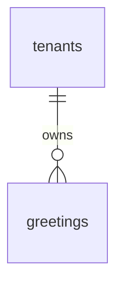

# Hello-world skeleton

**Approved**: 2026-11-24 - user: "ok i approve"

> Build this with **tlc-implement**. Every criterion becomes a check with a proof; nothing under
> the open questions is settled while building.

## Problem

Fairy has written conventions (`docs/conventions/`) and ADRs (`docs/adr/`), but no code. None of the rules has been run: tenant isolation through forced RLS with a transaction-local tenant, the pooled-connection traps D2 warns about, logs that never carry patient data, database-first migrations, and the CI gates. Every slice (Tenant, Workplace, Appointment, Agenda, Appointment changes) is blocked on the Conventions spike (#2). Tenant isolation is the most expensive thing to get wrong in the design. Today it is only prose, so the first slice would also be the first test of the pattern, with health data close behind.

Evidence: issue #2 asks for "a hello-world that passes CI … and reads one fake row … with tenant isolation tested on real Postgres". This plan covers the part that needs no cloud account. The deploy to the VM and reading from Neon follow in a later plan, once the accounts exist.

When this ships, anyone can clone the repo, run one command to start Postgres and one to start the app, and see a PT-BR page that reads a fake row through RLS. A pull request runs the eight CI gates, and a test fails if one tenant can reach another's rows, or if a canary patient name reaches the logs.

## Shape

This reuses only the conventions and ADRs. Nothing in the repo runs yet, so every module is new. The rules that change an outcome run in the Nest server, the database policies and the migrations. Vitest integration tests reach all three against real Postgres, and Playwright reaches the page.

1. Browser loads `/` -> `ServeStatic` (new) - returns the Vite build's `index.html`, and any unknown non-API `GET` gets `index.html`
2. SPA `HelloPage` (new) - calls `GET /hello` with TanStack Query, kept in memory only
3. `GET /hello` -> `HelloController` (new), `@Public()` - hands `DEMO_TENANT_ID` from config to `HelloService`
4. `HelloService` (new) -> `TenantDb.withTenant` (door 3) - opens a transaction, sets `app.tenant_id` locally, and reads that tenant's greeting as `fairy_app` (door 2)
5. Postgres - RLS policy (door 3) on `greetings` (door 1) returns only rows whose `tenant_id` matches
6. out: `200 {"message": …}` with `Cache-Control: no-store`. `LoggingInterceptor`/pino (new) writes one request line of chosen fields. Errors leave through `ProblemFilter` (new) as problem details (door 4).

```mermaid
sequenceDiagram
    participant B as Browser (HelloPage)
    participant S as ServeStatic
    participant C as HelloController
    participant H as HelloService
    participant T as TenantDb
    participant P as Postgres (RLS, as fairy_app)
    participant F as ProblemFilter
    B->>S: 1. GET /
    S-->>B: index.html + /assets/*
    B->>C: 2-3. GET /hello
    C->>H: 3. DEMO_TENANT_ID
    H->>T: 4. withTenant(DEMO_TENANT_ID)
    T->>P: 4. begin; set_config('app.tenant_id', id, true); select … from greetings
    P-->>T: 5. only that tenant's rows
    T-->>H: commit
    H-->>C: message
    C-->>B: 6. 200 {"message"}, no-store; request line logged
    C--)F: 6. on error
    F-->>B: 6. application/problem+json
```

**Changes underneath**

| Front | What changes |
| --- | --- |
| domain | nothing exists yet; `tenant` here is only an id, and the Tenant slice gives it meaning |
| stored data | nothing to migrate; first migrations on an empty database. The demo seed is a script, not a migration, so no fake row ever reaches a fresh production database by migrating |
| readers | `HelloPage` is the only reader. The Tenant slice drops `greetings` and `GET /hello` (contract step, ADR 0005) |



New: `tenants`, `greetings`, roles `fairy_app` and `fairy_admin`. One-way constraints: `tenants.id` uuid primary key (door 1); `greetings` references `tenants` through `tenant_id`, with `unique (tenant_id, id)` for composite references (door 1); forced RLS with the null-safe policy (door 3).

## Surface

| Route | In | Out | Status | Who |
| --- | --- | --- | --- | --- |
| `GET /hello` | nothing | `{"message": string}` | `200`; `503` problem `service_unavailable` when the database is unreachable | anyone (temporary, removed by the Tenant slice) |
| `GET /health/live` | nothing | `{"status":"ok"}` | `200` | anyone |
| `GET /health/ready` | nothing | `{"status":"ok"}` or `{"status":"unavailable"}` | `200`; `503` | anyone |
| `GET /*` (any path no API route matches) | nothing | the SPA's `index.html` | `200` | anyone |

## Landing

| One-way door | Literal shape | Alternative rejected |
| --- | --- | --- |
| 1. First tables | `tenants (id uuid primary key, created_at timestamptz not null default now())`; `greetings (id uuid primary key, tenant_id uuid not null references tenants(id), message text not null check (char_length(message) between 1 and 200), unique (tenant_id, id))`. The Tenant slice adds columns to `tenants` and drops `greetings` | Tenant's full columns now: settles the Tenant slice's schema before it is planned |
| 2. Roles without secrets in the repo | migration: `create role fairy_app nologin; create role fairy_admin nologin;` plus grants. Each environment enables login and sets the password outside the repo: compose init locally, the test setup in CI, a deploy step later | `create role … login password '…'` in a migration: the repo is public (ADR 0012) |
| 3. Tenant policy, null-safe | `alter table greetings enable row level security; alter table greetings force row level security; create policy tenant_isolation on greetings using (tenant_id = nullif(current_setting('app.tenant_id', true), '')::uuid) with check (tenant_id = nullif(current_setting('app.tenant_id', true), '')::uuid);`, the same on `tenants` with `id`. Context is set only by `set_config('app.tenant_id', $1, true)` inside `TenantDb.withTenant` | `current_setting(...)::uuid` without `nullif`: after any transaction that set it, the setting reads `''` on that pooled connection and the cast throws instead of returning no rows |
| 4. Error contract | `Content-Type: application/problem+json`, body `{"type": "<code>", "title": "<English text>", "status": <int>}`, with optional `"errors": [{"path": string, "code": string}]` for `validation_error`. Codes: `validation_error`, `not_found`, `service_unavailable`, `internal_error`. Clients branch on `type` only | Nest's default `{statusCode, message, error}`: not RFC 9457 (framework.md), and `message` can echo input |
| 5. Health paths | `/health/live` never touches the database; `/health/ready` runs `select 1` | `/healthz` alone: one endpoint can't both avoid waking Neon and prove the database before a switch |
| 6. Node and package manager | `.nvmrc` = `26`, `engines.node` = `>=26 <27`, `packageManager` = a pinned `pnpm@<version>` through corepack | Node 24: no longer Active LTS since 2026-10-28, which the convention requires |

- Nothing else in this change is hard to reverse. Dependencies are the ones the ADRs already chose.

## Criteria

### S1: The page shows a greeting read through RLS (P1)

A person who runs the app locally sees the demo tenant's greeting from the database, at phone and desktop widths.

**Acceptance Criteria**

1. WHEN `GET /hello` is called with the demo tenant seeded THEN the system SHALL respond `200` with body exactly `{"message":"Olá do banco de dados!"}` and header `Cache-Control: no-store`
2. WHEN `GET /hello` is called and two tenants are seeded with different greetings THEN the system SHALL return only the greeting of the tenant whose id is `DEMO_TENANT_ID`
   - demo tenant's greeting "Olá do banco de dados!", other tenant's "Outro tenant" → `{"message":"Olá do banco de dados!"}`
3. IF the database is unreachable when `GET /hello` is called THEN the system SHALL respond `503` with `application/problem+json` and `"type":"service_unavailable"`
4. WHEN a person opens `/` at the `Pixel 7` and the `Desktop Chrome` Playwright sizes THEN the page SHALL show the title "Fairy" and the text "Olá do banco de dados!"
5. WHILE `GET /hello` has not answered THEN the page SHALL show "Carregando…"
6. IF `GET /hello` fails THEN the page SHALL show "Não foi possível carregar." and a "Tentar de novo" button; WHEN the person presses "Tentar de novo" and `GET /hello` then succeeds THEN the page SHALL show "Olá do banco de dados!"
7. WHEN any path no API route matches is requested with `GET`, for example `/agenda/semana` THEN the system SHALL respond `200` with the SPA's `index.html` and `Cache-Control: no-cache`
8. WHEN a hashed file under `/assets/` is requested THEN the system SHALL respond with `Cache-Control: public, max-age=31536000, immutable`
9. WHEN `GET /health/live` is called THEN the system SHALL respond `200 {"status":"ok"}` without opening a database connection
   - database stopped → still `200`
10. WHEN `GET /health/ready` is called THEN the system SHALL respond `200 {"status":"ok"}` if `select 1` succeeds and `503 {"status":"unavailable"}` if it does not
11. IF a required environment variable (`DATABASE_URL` or `DEMO_TENANT_ID`) is missing or malformed at startup THEN the app SHALL exit with a non-zero code and print the variable's name, never its value
    - `DEMO_TENANT_ID=abc` (not a UUID) → exits non-zero, output names `DEMO_TENANT_ID` and does not contain `abc`

### S2: One tenant can never reach another's rows (P1)

The isolation rules of D2 and data-access.md hold against real Postgres, run as `fairy_app`.

**Acceptance Criteria**

12. WHILE the tenant context is tenant A THEN a `select` from `greetings` as `fairy_app` SHALL return only tenant A's rows, with or without a `where tenant_id` clause
    - `select * from greetings` → A's rows only; `select * from greetings where tenant_id = '<B>'` → 0 rows
13. WHILE the tenant context is tenant A THEN an `update` or `delete` targeting tenant B's greeting SHALL affect 0 rows, and B's row SHALL be unchanged afterwards
14. IF tenant A's context inserts a greeting with `tenant_id` = B THEN Postgres SHALL reject it with SQLSTATE `42501`
15. IF no tenant context is set THEN a `select` from `greetings` and from `tenants` as `fairy_app` SHALL return 0 rows and no error
16. WHEN a `withTenant` transaction for tenant A has finished THEN a later query on the same pooled connection without tenant context SHALL return 0 rows and no error
    - pool `max: 1`: `withTenant(A)` → select returns A's rows; then a plain select → 0 rows (not `22P02` invalid uuid)
17. WHEN all migrations are applied to an empty database THEN every table with a `tenant_id` column SHALL have `relrowsecurity` and `relforcerowsecurity` true, and `tenants` SHALL too
18. WHEN all migrations are applied THEN `fairy_app` SHALL own no table and SHALL NOT have `BYPASSRLS`
19. WHEN `pnpm db:migrate` runs on an empty database THEN it SHALL apply every file in `db/migrations/` and exit `0`; WHEN it runs again THEN it SHALL apply nothing and exit `0`
20. WHEN `pnpm db:seed` runs twice THEN the database SHALL hold exactly one demo tenant and one greeting for it

### S3: Logs never carry patient data (P1)

The logging convention, proven by canaries.

**Acceptance Criteria**

21. WHEN any request completes THEN the system SHALL write exactly one JSON request line with `reqId`, `method`, `route` (the route pattern, never the raw URL), `status` and `ms`, and SHALL set the `X-Request-Id` response header to that `reqId`
    - `GET /hello?nome=Maria` → `route` is `/hello` and no logged field contains `nome=Maria`
22. WHEN requests carrying the canaries `Paciente Canário Zé`, `+55 11 98888-7777`, `canario@example.com` and the cookie `sid=canario-secret` in the body, the query string, a header and the cookie go through a success path, a `400 validation_error` path, a unique-violation path and a check-violation path THEN no captured log line SHALL contain any canary
23. WHEN a database error is logged THEN the log entry SHALL contain the error class, the Postgres `code`, and `constraint` and `table` where present, and SHALL NOT contain `message`, `detail`, `query` or `params`
    - check violation on `greetings` → entry has `code: "23514"` and `constraint`, no `detail`
24. IF an unexpected error reaches the global filter THEN the response SHALL be `500` problem `internal_error`, with no stack trace or error message in the body
25. IF a request body fails Zod validation THEN the response SHALL be `400` problem `validation_error`, whose `errors` list paths and codes and never the rejected values
26. The server source SHALL contain no `console.*` call (ESLint `no-console` as an error)

### S4: A pull request runs the eight gates (P1)

**Acceptance Criteria**

27. WHEN a pull request is opened or updated THEN GitHub Actions SHALL run, in order of dependency: frozen-lockfile install; Prettier check and ESLint; `tsc --noEmit`; migrations untouched; unit and integration tests against a Postgres service container; schema in sync; client and server build; Playwright against the build at both widths
28. IF a pull request modifies or deletes a file under `db/migrations/` that exists on `main` THEN the migrations-untouched gate SHALL fail; adding a new file SHALL pass
    - edit `0001_*.sql` → fails; delete it → fails; add `0003_x.sql` → passes
29. IF the committed files in `src/server/db/generated/` differ from what `pnpm db:pull` produces after migrating an empty database THEN the schema-in-sync gate SHALL fail
30. WHEN CI runs on pull request #19 THEN every gate job SHALL pass

### S5: One image runs the whole app (P2)

**Acceptance Criteria**

31. WHEN `docker build .` runs THEN it SHALL produce an image that starts the server, serving both `GET /health/live` → `200` and `GET /` → `index.html`
32. WHEN the image runs THEN its process SHALL run as a non-root user (uid ≠ 0), and the image SHALL contain no dev dependency
    - `node_modules/vitest` and `node_modules/@playwright/test` absent from the image
33. WHEN a developer runs `docker compose up -d db`, `pnpm db:migrate`, `pnpm db:seed` and `pnpm dev` from a fresh clone with `.env` copied from `.env.example` THEN the page at the local `PORT` SHALL show "Olá do banco de dados!"

## Out of scope

| Excluded | Why |
| --- | --- |
| Deploy, blue-green, Caddy, systemd, cloud-init, Ansible | need the Locaweb account; next plan |
| Terraform, Cloudflare, Access | need the Cloudflare account; next plan |
| Reading from Neon, cold start | need the Neon account; spike #3 |
| OpenTelemetry metrics, Alloy, Grafana | need the Grafana account and the VM; next plan |
| Pushing images to GHCR | belongs to the deploy workflow |
| Sign-in, sessions, invitations, `SessionGuard` beyond `@Public()` | Tenant slice (#5) |
| Admin command using `fairy_admin` | Tenant slice; the role is only created here |
| Adding the CI jobs as required checks on `main` | a GitHub setting outside the repo; done after the first green run, with the owner's go-ahead |
| Composite foreign key between two tenant-owned tables in a test | only `greetings` is tenant-owned here; the first slice with two such tables proves it |

## Assumptions

| Assumption | Chosen default | Rationale | Confirmed? |
| --- | --- | --- | --- |
| Which tables the first migration creates | minimal `tenants` (`id`, `created_at`) plus a throwaway tenant-owned `greetings` with forced RLS; the Tenant slice extends `tenants` and drops `greetings` | user chose "Minimal tenants + demo table" | y |
| How `GET /hello` picks a tenant without sign-in | public route reading through `TenantDb.withTenant(DEMO_TENANT_ID)` from config; removed by the Tenant slice | user chose "Fixed demo tenant" | y |
| Page copy and states | title "Fairy", greeting "Olá do banco de dados!", loading "Carregando…", error "Não foi possível carregar." with a "Tentar de novo" button | user chose "Greeting from the database" | y |
| Demo data | `pnpm db:seed` script, idempotent, fixed `DEMO_TENANT_ID` from env; never a migration | a seed in a migration would put fake rows into the clean go-live database (D3) | n |
| Postgres version locally and in CI | the official `postgres:17` image | widely supported by Neon; the deploy plan confirms the Neon project's version and aligns it | n |
| Node version | Node 26 (Active LTS since 2026-10-28) via `.nvmrc`; the owner installs it locally (machine has 24) | layout-and-style.md says Active LTS | n |
| Playwright browsers | Chromium only, for both `devices['Pixel 7']` and `Desktop Chrome` | both projects are Chromium-based; fewer browsers keeps CI minutes down | n |
| Where tests get `fairy_app` login | integration test setup runs `alter role fairy_app login password '<random per run>'` as the owner, after migrating | keeps passwords out of migrations (door 2) | n |

**Open questions:** none - all resolved or logged above.

## Differences from the source

None - no capture or design source binds this feature

## Sources

- Issue #2 (Spike: engineering conventions) - binding - the hello-world proof and its scope
- `docs/conventions/*.md` and `docs/adr/0001`–`0012` on branch `spike/2-code-conventions` - binding - every rule this skeleton must follow
- `.design/first-version.md` D2, D3, D4, D9, D10 - binding - isolation, data location, patient data, server, widths
